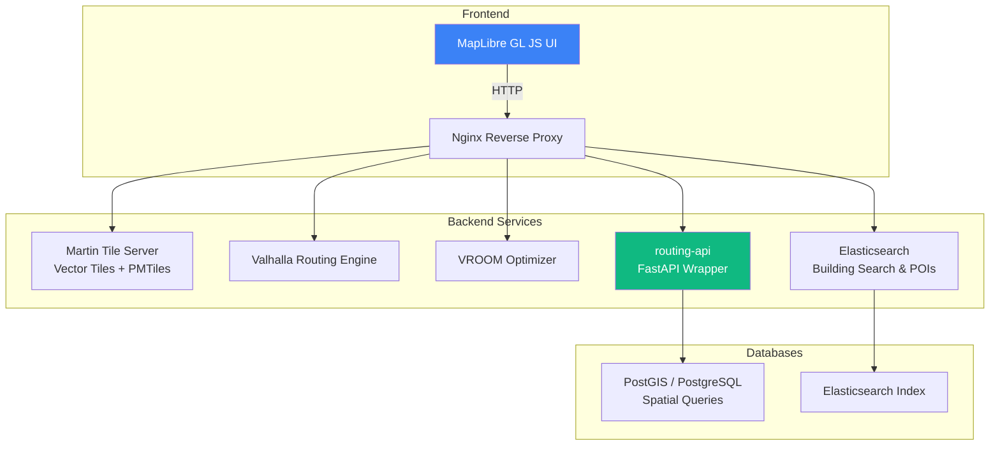
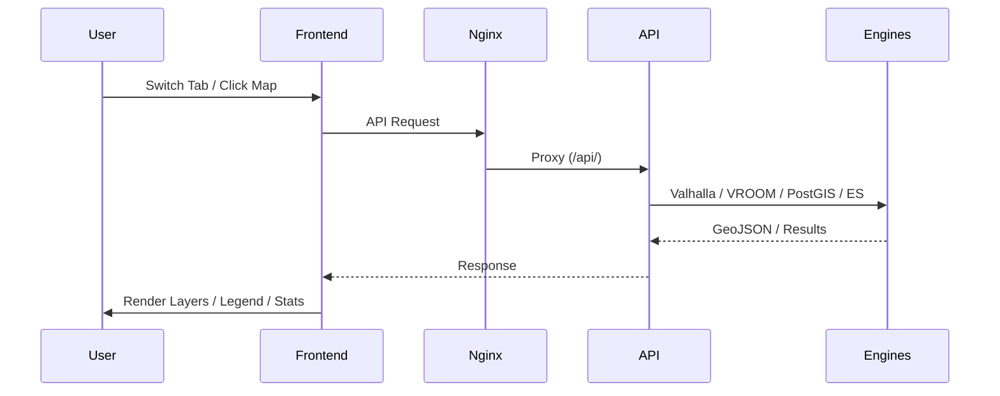
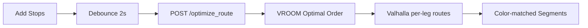
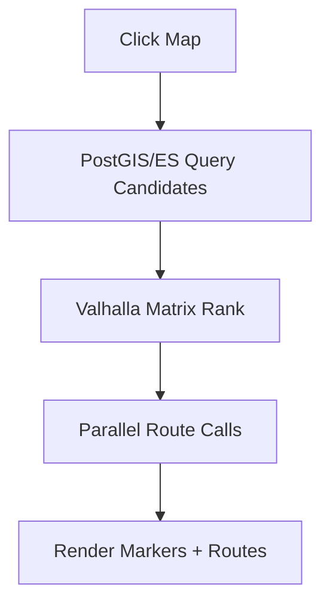

# GeoRouting Lab — Interactive Mapping & Routing Application

**A comprehensive geospatial web app** for route comparison, VRP/TSP optimization, isochrones, nearest facilities, and indoor building search. Built with MapLibre GL JS, powered by Valhalla, VROOM, PostGIS, Elasticsearch, and Martin tile server.

## Table of Contents
- [Overview](#overview)
- [Architecture & Pipeline](#architecture--pipeline)
- [Setup Instructions](#setup-instructions)
- [Data Preparation](#data-preparation)
- [Application Workflow](#application-workflow)
- [Feature Flowcharts](#feature-flowcharts)
- [Usage Guide](#usage-guide)
- [Troubleshooting](#troubleshooting)

## Overview

GeoRouting Lab provides an intuitive interface for advanced location-based tasks in Riyadh (and similar regions). Key capabilities:
- **Route Comparison**: Multiple alternatives (fastest, avoid highways, shortest).
- **VRP / TSP**: Optimize multi-stop delivery or travel sequences.
- **Isochrone**: Visualize reachable areas in time rings.
- **Nearest Facility**: Find and route to hospitals, police, etc.
- **Building Search**: Search vertical addresses and indoor units with 3D highlighting.

## Architecture & Pipeline



### Component Roles
| Component       | Purpose                              | Port (internal) |
|-----------------|--------------------------------------|-----------------|
| **Nginx**       | Reverse proxy, static serving        | 80 → 3001      |
| **Martin**      | Vector tile server (PostGIS + files) | 3000           |
| **Valhalla**    | Routing, isochrones, matrix          | 8002           |
| **VROOM**       | VRP/TSP optimization                 | 3000           |
| **routing-api** | FastAPI orchestration layer          | 5000           |
| **PostGIS**     | Spatial facility search              | 5432           |
| **Elasticsearch**| Building search & POI queries       | 9200           |

**Data Flow**:
1. User interacts with map → frontend JS.
2. Requests proxied via Nginx (`/api/`, `/es/`, `/tiles/` etc.).
3. routing-api coordinates Valhalla/VROOM/PostGIS/ES.
4. Results rendered back as GeoJSON / MapLibre layers.

## Setup Instructions

### 1. Prerequisites
- Docker & Docker Compose
- Sufficient RAM (≥8GB recommended, 16GB+ ideal)
- Git

### 2. Clone & Prepare
```bash
git clone <your-repo>
cd georouting-lab

# Create directories
mkdir -p data/pbf data/mbtiles data/pmtiles data/sprites data/fonts styles config frontend/js frontend/css

# Copy provided files
# - docker-compose.yml
# - martin-config.yml
# - nginx.conf
# - app.py (routing-api/)
# - style.json etc. to styles/
```

### 3. Environment Variables (`.env`)
```env
POSTGRES_DB=geodb
POSTGRES_USER=postgres
POSTGRES_PASSWORD=your_secure_password
PGADMIN_EMAIL=admin@admin.com
PGADMIN_PASSWORD=admin

# Optional tuning
POSTGRES_HOST=postgis
```

### 4. Start Services
```bash
docker-compose up -d --build

# Monitor logs
docker-compose logs -f routing-api valhalla martin
```

### 5. Verify Health
- App: http://localhost:3001
- Health: http://localhost:3001/api/health
- Martin: http://localhost:3000
- Kibana (optional): http://localhost:5601

### 6. Load Data (Post-Setup)
- Import PBF to Valhalla (via volume mount).
- Load building data to PostGIS/ES.
- Generate MBTiles/PMTiles for Martin.
- Index POIs in Elasticsearch.

## Data Preparation

1. **Valhalla**: Place `.osm.pbf` in `./data/pbf/` → restart valhalla service.
2. **PostGIS**: Use pgAdmin (port 5050) or psql to import spatial data.
3. **Elasticsearch**: Use scripts to bulk index building floors/units.
4. **Martin**: Configure `martin-config.yml` with your tables/PMTiles.

## Application Workflow



**Tab Flow**:
- **Route**: Pick S/E → Compute 3 variants → Draw + Legend.
- **VRP**: Add stops → Debounce → Optimize → Draw colored segments.
- **Isochrone**: Pick origin → Compute rings → Style by time.
- **Facility**: Pick type/location → Query + Route → Markers + Lines.
- **Search**: Query ES → List → Click → 3D highlight + Popup.

## Feature Flowcharts

### Route Comparison


### VRP/TSP


### Nearest Facility


## Usage Guide

1. **Open** http://localhost:3001
2. **Explore tabs** in sidebar.
3. **Layer Switcher** (bottom-right): Default / Satellite / 3D / BDF (indoor).
4. **Info Pointer** (ℹ️): Inspect any feature.
5. **Sidebar Toggle**: Collapse for full map view.

**Tips**:
- Use BDF style for indoor search.
- Zoom/pan freely; overlays persist on style change.
- Status bar shows feedback.

## Troubleshooting

- **Services not healthy**: Check `docker-compose logs`.
- **No tiles**: Verify Martin config + data volumes.
- **Routing fails**: Ensure Valhalla has data for area.
- **ES search empty**: Confirm index populated.
- **CORS issues**: Nginx handles most; check console.

---

**Made with ❤️ for geospatial enthusiasts.**

For contributions or issues, refer to the project repository.
```

## Next Steps
- Populate data directories.
- Customize styles in `/styles/`.
- Extend with new endpoints in `app.py`.