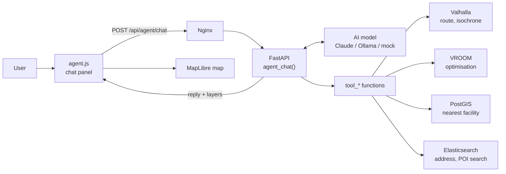
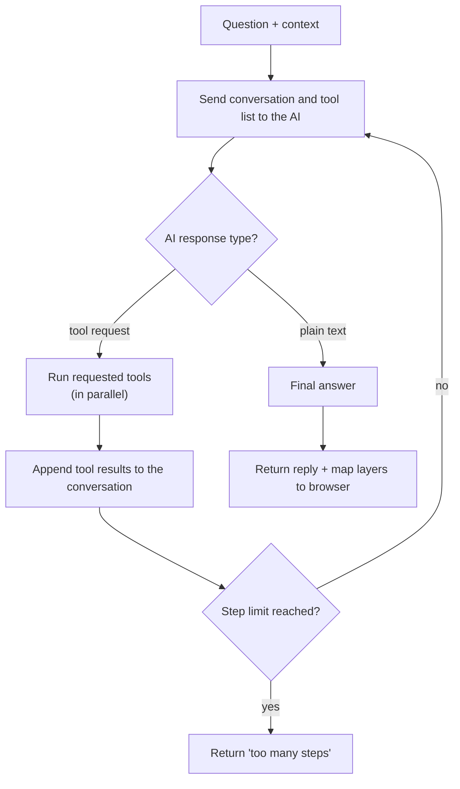
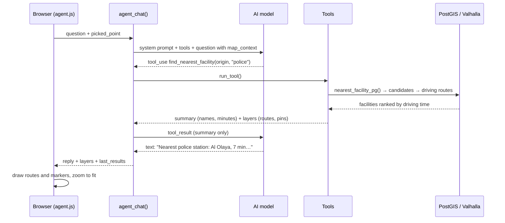

# GeoRouting Lab — Agentic Layer

How the map assistant works, from a typed question to results drawn on the map.

| | |
|---|---|
| **Backend** | `routing-api/agent.py` (mounted into `app.py`) |
| **Frontend** | `frontend/js/agent.js`, `frontend/css/agent.css` |
| **Endpoint** | `POST /api/agent/chat` |
| **AI providers** | Claude (Anthropic API), any OpenAI-compatible server (Ollama, vLLM), or mock rules |

---

## Contents

1. [What the agentic layer is](#1-what-the-agentic-layer-is)
2. [Architecture](#2-architecture)
3. [The core mechanism: the agent loop](#3-the-core-mechanism-the-agent-loop)
4. [Tools](#4-tools)
5. [Context: how the agent knows "here"](#5-context-how-the-agent-knows-here)
6. [The brains (providers)](#6-the-brains-providers)
7. [A full example, step by step](#7-a-full-example-step-by-step)
8. [Frontend: drawing results on the map](#8-frontend-drawing-results-on-the-map)
9. [API reference](#9-api-reference)
10. [Configuration](#10-configuration)
11. [Safety and guardrails](#11-safety-and-guardrails)
12. [Logging and feedback](#12-logging-and-feedback)
13. [Extending: adding a new tool](#13-extending-adding-a-new-tool)
14. [Testing](#14-testing)
15. [Troubleshooting](#15-troubleshooting)

---

## 1. What the agentic layer is

GeoRouting Lab already has four GIS functions, each driven by buttons and map clicks: route comparison, VRP/TSP, isochrones and nearest facility. The agentic layer adds a chat panel where users ask in plain English or Arabic instead:

> "Route from my point to the nearest police station"
> "أقرب مستشفى إلى النقطة المحددة"
> "Show the 10, 20 and 30 minute drive area from here"

An AI model reads the question, decides **which GIS functions to call and in what order**, calls them, and writes a short answer. The map draws the results.

The important design choice: **the AI never touches your data or services directly.** It can only request one of six predefined tools. Your existing Python code runs each tool and decides what goes back. The AI is the decision-maker; your code is the executor.

### A mental model

Think of the AI as a dispatcher who cannot see the map:

| Part of the system | In the analogy |
|---|---|
| `SYSTEM_PROMPT` | The dispatcher's job description |
| `TOOLS` (schemas) | The phone list, with a note on when to call each number |
| `tool_*` functions | Your existing services answering the phone |
| The agent loop | The dispatcher making calls until they can answer |
| Map layers | The drawings handed to the user afterwards |

---

## 2. Architecture



Key points:

- **No new services.** The agent lives inside the existing `routing-api` container as a FastAPI router (`/agent/...`).
- **No extra HTTP hop to your own API.** Tools call `app.py` helpers in-process: `core._forward()` for Valhalla and VROOM, `core.nearest_facility_pg()` for PostGIS, and `core.client` for Elasticsearch.
- **The AI only exchanges text and JSON.** It never receives geometry, credentials or raw database rows.

### How it is wired into `app.py`

Two lines near the bottom of `app.py`:

```python
if __name__ != "__main__":
    from agent import router as agent_router
    app.include_router(agent_router)
```

The `if` guard prevents a double import when the service is started with `python app.py`, because `uvicorn.run("app:app")` then re-imports the file under the name `app`.

---

## 3. The core mechanism: the agent loop

This is the heart of the system. Everything else supports it.



In pseudo-code:

```text
messages = [user question + map context]

repeat up to MAX_STEPS (8) times:
    response = AI(system_prompt, tools, messages)

    if response is plain text:
        return response                       # done

    for each tool the AI requested:            # may be several at once
        result, layers = run_tool(name, args)  # your code runs it
        collect layers for the map
        add result to messages                 # the AI reads it next round
```

The real implementation (`_loop_anthropic` in `agent.py`) is about 25 lines.

### Why a loop and not a single call?

Many questions need several dependent steps. For "route from my point to the nearest police station", the AI first needs to know *which* police station is nearest before it can ask for a route. The loop lets the AI:

1. call a tool,
2. read the result,
3. decide the next step based on that result,
4. stop when it has enough to answer.

This "observe, then decide" cycle is what makes it an **agent** rather than a fixed pipeline.

### The two outputs of every tool

Each `tool_*` function returns **two separate things**:

| Output | Goes to | Contains | Why |
|---|---|---|---|
| `summary` | The AI | Names, minutes, km, IDs, a few coordinates | The AI needs facts to reason and answer |
| `layers` | The browser map | Full GeoJSON geometry (lines, polygons, points) | The user needs to see the result |

Example from `find_nearest_facility`:

```json
// summary → AI (small)
{
  "facility_type": "hospital",
  "count": 2,
  "facilities": [
    {"rank": 1, "name": "King Fahad Hospital", "drive_minutes": 6.5, "straight_line_km": 3.1, "lon": 46.68, "lat": 24.72},
    {"rank": 2, "name": "Al Noor Clinic Hospital", "drive_minutes": 9.2, "straight_line_km": 4.0, "lon": 46.71, "lat": 24.69}
  ]
}
```

```json
// layers → map (large)
[
  {"kind": "line",   "label": "Routes to hospital", "color": "#ef4444", "geojson": {"type": "FeatureCollection", "features": ["...hundreds of coordinates..."]}},
  {"kind": "points", "label": "Nearest hospital",   "color": "#ef4444", "geojson": {"type": "FeatureCollection", "features": ["..."]}}
]
```

Keeping geometry away from the AI makes answers faster and cheaper, and keeps the model focused on facts rather than thousands of coordinates.

### Parallel tool calls

If the AI requests several independent tools in one round (for example, an isochrone and an address search), `_execute()` runs them at the same time with `asyncio.gather`, so the user waits for the slowest call only, not the sum.

---

## 4. Tools

Tools are defined in two places in `agent.py`:

1. **Schema** in the `TOOLS` list. This is what the AI reads: a name, a description of *when* to use it, and a JSON Schema for its parameters.
2. **Implementation**, an `async def tool_*()` function, registered in `TOOL_FUNCS`.

The AI never sees the Python code, only the schema. **The quality of the descriptions largely determines how well the agent chooses tools.**

### Available tools

| Tool | Uses | Purpose | Main inputs |
|---|---|---|---|
| `search_address` | Elasticsearch `building_floors` / `building_units` | Find Vertical Address, Short Address, units | `query`, `dataset` |
| `search_places` | Elasticsearch `pois` | Find a named place (e.g. a specific hospital) | `name`, `facility_type?`, `near?`, `radius_km?` |
| `get_route` | Valhalla `/route` | Route with distance, time, instructions | `origin`, `destination`, `via?`, `profile`, `preference` |
| `compute_isochrone` | Valhalla `/isochrone` | Area reachable within N minutes | `origin`, `minutes[]` (max 4), `profile` |
| `find_nearest_facility` | PostGIS + Valhalla | Nearest facilities by real driving time | `origin`, `facility_type`, `limit`, `max_distance_km` |
| `optimize_stops` | VROOM | Best visiting order, optional multi-vehicle | `stops[]` (first = depot), `mode`, `vehicle_count` |

All points use the format `{"lon": <longitude>, "lat": <latitude>}`, matching GeoJSON order.

### Example schema

```python
{
    "name": "compute_isochrone",
    "description": (
        "Area reachable from a point within given travel times (service area / catchment). "
        "Use for coverage, accessibility and 'how far can I get in N minutes' questions."
    ),
    "input_schema": {
        "type": "object",
        "properties": {
            "origin":  {"type": "object", "properties": {"lon": {"type": "number"}, "lat": {"type": "number"}}},
            "minutes": {"type": "array", "items": {"type": "integer", "minimum": 1, "maximum": 60}, "maxItems": 4},
            "profile": {"type": "string", "enum": ["auto", "bicycle", "pedestrian"]}
        },
        "required": ["origin", "minutes"]
    }
}
```

### Error handling: errors are information, not crashes

`run_tool()` wraps every tool call. Any failure becomes a readable message returned to the AI, instead of an exception that stops the request:

```json
{"error": "origin is out of range. Did you swap lon and lat?"}
```

The AI reads this on the next loop round and can correct itself (for example, swap the coordinates and retry) or explain the problem to the user. Error sources handled:

| Source | Example |
|---|---|
| `ToolError` (validation in our code) | Missing or invalid coordinate |
| `HTTPException` (from `app.py` helpers) | Valhalla returned 400 for an unreachable point |
| `TypeError` | The AI sent an unknown parameter |
| Any other exception | Logged with stack trace; AI gets a short message |

---

## 5. Context: how the agent knows "here"

The AI cannot see the map, so the browser sends context with every question. `agent_chat()` appends it to the user's latest message inside a `<map_context>` block:

```text
Nearest hospital to my point

<map_context>
Picked point: {"lon": 46.6753, "lat": 24.7136}
Map center: {"lon": 46.70, "lat": 24.72} (zoom 12.5)
Results from the previous answer (for 'the second one', 'that hospital'): [...]
</map_context>
```

| Context field | Source | Used for |
|---|---|---|
| `picked_point` | User clicks **📍 Pick point** then the map | "here", "my point", "هنا" |
| `map_center`, `map_zoom` | Current map view | Only when the user explicitly says "map center" or "this area" |
| `last_results` | Compact tool results returned with the previous answer | Follow-ups: "route to the second one" |

### Conversation memory

The server is **stateless**: it stores no conversation. The browser keeps the history and sends it each time:

- `messages`: the last 20 text messages (user and assistant).
- `last_results`: up to 3 compact tool summaries from the previous answer, so references like "the second hospital" resolve to real coordinates.

This keeps the backend simple and lets it scale horizontally without shared session storage.

### The system prompt

`SYSTEM_PROMPT` sets the rules the AI follows on every request. The main rules:

- Never invent coordinates. Use the picked point, a tool result, or numbers the user typed.
- If there is no picked point and the user says "here", ask them to pick one.
- Use `search_address` for addresses and `search_places` for named places; if several match, ask which one.
- `optimize_stops` produces a draft plan only; nothing is dispatched.
- Answer in the user's language, key numbers first, briefly; the map already shows the geometry.

Editing this text is the simplest way to change the agent's behaviour, and needs no Python knowledge. Re-test after every change.

---

## 6. The brains (providers)

The agent loop is the same idea in all modes; only the "brain" that chooses tools differs. Select it with `AGENT_PROVIDER`.

| Provider | Function | Needs | Notes |
|---|---|---|---|
| `anthropic` | `_loop_anthropic()` | `ANTHROPIC_API_KEY` | Best quality tool selection and Arabic handling |
| `openai` | `_loop_openai()` | An OpenAI-compatible server, e.g. Ollama | Free, self-hosted, data stays on your servers. Use a model with tool calling (e.g. `qwen2.5:7b`) |
| `mock` | `_loop_mock()` | Nothing | Keyword rules, no AI. For testing the wiring and UI only |

Default: `anthropic` if `ANTHROPIC_API_KEY` is set, otherwise `mock`.

### How the formats differ

The Anthropic and OpenAI-compatible APIs express the same loop with different message shapes:

| Step | Anthropic format | OpenAI-compatible format |
|---|---|---|
| Tool list | `tools=[{name, description, input_schema}]` | `tools=[{type: "function", function: {name, description, parameters}}]` |
| AI requests a tool | Content block `type: "tool_use"` | `message.tool_calls[]`, arguments as a JSON string |
| Tool result back | User message with `type: "tool_result"` blocks | Message with `role: "tool"` and `tool_call_id` |
| Loop ends when | `stop_reason != "tool_use"` | No `tool_calls` in the message |

`OPENAI_TOOLS` is generated automatically from `TOOLS`, so tools are defined once for both.

### Mock mode rules

Mock mode recognises only these patterns, in this order:

| Pattern in the question | Tool called |
|---|---|
| A short address code like `RRRD2929` | `search_address` |
| "nearest/closest/أقرب/route" + hospital, clinic, police, fire | `find_nearest_facility` |
| "minute", "isochrone", "reach", "دقيقة" … | `compute_isochrone` (numbers in the text become bands; default 10/20/30) |
| "route", "directions", "طريق" | `get_route` to the first result of the previous answer |
| Anything else | Help message |

---

## 7. A full example, step by step

**User** picks a point in Riyadh and asks: *"Route from my point to the nearest police station"*.



**Round 1.** The AI receives the question with the picked point in `<map_context>`. It recognises "nearest police station" and requests:

```json
{"name": "find_nearest_facility",
 "input": {"origin": {"lon": 46.6753, "lat": 24.7136}, "facility_type": "police", "limit": 3, "max_distance_km": 5}}
```

**Tool execution.** `tool_find_nearest_facility()` calls the existing `nearest_facility_pg()`: PostGIS finds candidates by straight-line distance, Valhalla computes real driving times, and results are ranked by time with routes attached. The tool splits this into a small summary and map layers.

**Round 2.** The AI reads the summary. The nearest-facility tool already includes routes, so no further tool is needed. It writes:

> Nearest police station: **Al Olaya Police Station**, 7 min drive.
> 2. Al Malaz Police Station, 11 min
> 3. Al Murabba Police Station, 13 min

**Browser.** Shows the reply, draws three routes (the nearest one thicker) and numbered markers, and zooms the map to fit. It stores `last_results`, so a follow-up "show the 10-minute drive area around the second one" resolves to Al Malaz's coordinates.

---

## 8. Frontend: drawing results on the map

`agent.js` is loaded after `scripts.js` and reuses its `state.map`, `makeStopEl()` and `exitMode()`.

### Main functions

| Function | Role |
|---|---|
| `agentBuildPanel()` | Creates the chat panel, example chips, and keyboard handling |
| `agentStartPick()` / `agentSetPoint()` | One-shot map click → star marker → `pickedPoint` |
| `agentSend()` | Builds `{messages, context}`, calls the API, shows the reply, draws layers |
| `agentDrawLayers()` | Clears previous agent results, draws new ones, zooms to fit |
| `agentAddMapLayers()` | Adds line and polygon layers; also re-run after a basemap switch |
| `agentClearMap()` | Removes all agent layers and markers |

### Layer kinds

Every layer returned by the backend has a `kind` that decides how it is drawn:

| `kind` | Produced by | Drawn as |
|---|---|---|
| `line` | Routes, VRP vehicle routes, facility routes | MapLibre `line` layer with a dark casing; nearest-facility route drawn thicker |
| `polygon` | Isochrones | `fill` (14% opacity) + outline, colored per band |
| `points` | Facilities, stops, address results, origins | HTML markers with a label and popup |

Colors come from each feature's `color` property, falling back to the layer's `color`.

### Surviving a basemap switch

`map.setStyle()` removes all sources and layers. `restoreActiveLayers()` in `scripts.js` calls `window.agentRestoreLayers?.()`, which re-adds agent line and polygon layers from the stored `agent.layers`. HTML markers are not part of the style, so they survive on their own.

### Right-to-left text

Messages use `dir="auto"`, so Arabic replies display right-to-left automatically.

---

## 9. API reference

All paths are behind Nginx at `/api/agent/...` (FastAPI serves them at `/agent/...`).

### `POST /api/agent/chat`

Request:

```json
{
  "messages": [
    {"role": "user", "content": "Nearest hospital to my point"}
  ],
  "context": {
    "picked_point": {"lon": 46.6753, "lat": 24.7136},
    "map_center":   {"lon": 46.70, "lat": 24.72},
    "map_zoom":     12.5,
    "last_results": null
  }
}
```

Response:

```json
{
  "request_id": "6f1c…",
  "reply": "Nearest hospital: **King Fahad Hospital**, 6.5 min drive.",
  "layers": [{"kind": "line", "label": "Routes to hospital", "color": "#ef4444", "geojson": {}}],
  "last_results": [{"tool": "find_nearest_facility", "result": {}}],
  "tools_used": ["find_nearest_facility"]
}
```

| Status | Meaning |
|---|---|
| 400 | Last message not from the user, or message over 2,000 characters |
| 429 | Rate limit exceeded (default 20 questions per minute per IP) |
| 502 | AI service or model server unavailable |
| 503 | `anthropic` provider selected but no API key set |

### `POST /api/agent/feedback`

```json
{"request_id": "6f1c…", "rating": "down", "comment": "Picked the wrong hospital"}
```

### `GET /api/agent/health`

```json
{"provider": "openai", "model": "qwen2.5:7b", "configured": true,
 "tools": ["search_address", "search_places", "get_route", "compute_isochrone", "find_nearest_facility", "optimize_stops"],
 "debug_tools_endpoint": true}
```

### `POST /api/agent/tool/{name}` (debug)

Runs one tool directly, with no AI. The body is the tool's arguments:

```bash
curl -X POST http://localhost/api/agent/tool/compute_isochrone \
  -H "Content-Type: application/json" \
  -d '{"origin": {"lon": 46.6753, "lat": 24.7136}, "minutes": [10, 20]}'
```

Disabled with `AGENT_DEBUG_TOOLS=0`.

---

## 10. Configuration

Set these environment variables on the `routing-api` service.

| Variable | Default | Description |
|---|---|---|
| `AGENT_PROVIDER` | `anthropic` if a key is set, else `mock` | `anthropic`, `openai`, or `mock` |
| `ANTHROPIC_API_KEY` | — | Required for `anthropic` |
| `AGENT_MODEL` | `claude-sonnet-5-5` / `qwen2.5:7b` | Model name for the chosen provider |
| `AGENT_BASE_URL` | `http://ollama:11434/v1` | OpenAI-compatible server URL |
| `AGENT_API_KEY` | `ollama` | Key for the OpenAI-compatible server (Ollama ignores it) |
| `AGENT_MAX_STEPS` | `8` | Maximum tool rounds per question |
| `AGENT_RATE_LIMIT_PER_MIN` | `20` | Questions per minute per client IP |
| `AGENT_LOG_FILE` | `agent_log.jsonl` | Interaction and feedback log |
| `AGENT_DEBUG_TOOLS` | `1` | Enable `/agent/tool/{name}`; set `0` in production |

Example `docker-compose.yml` fragment (Ollama mode):

```yaml
routing-api:
  environment:
    - AGENT_PROVIDER=openai
    - AGENT_BASE_URL=http://ollama:11434/v1
    - AGENT_MODEL=qwen2.5:7b
    - AGENT_LOG_FILE=/app/logs/agent_log.jsonl
    - AGENT_DEBUG_TOOLS=0
  volumes:
    - ./logs:/app/logs
```

Nginx gives `/api/agent/` a 180-second read timeout, because one question may run several tools plus the model. The browser aborts after 150 seconds.

---

## 11. Safety and guardrails

| Risk | Guardrail |
|---|---|
| AI invents locations | System prompt forbids it; coordinates must come from the picked point, a tool, or the user |
| Bad or swapped coordinates | `_pt()` validates ranges and returns a hint the AI can act on |
| Endless tool loops | `MAX_STEPS` (default 8) per question |
| Cost or abuse | Per-IP rate limit; 2,000-character message limit; 256 KB request body limit in Nginx |
| AI triggering real-world actions | All tools are read-only. `optimize_stops` returns a draft plan; nothing is dispatched |
| Facility type injection into SQL | `find_nearest_facility` uses the existing allow-list `_ALLOWED_FACILITY_TYPES` and parameterised queries |
| Out-of-range parameters | Tools clamp values (radius 1–20 km, limit 1–10, isochrone 1–60 min, max 4 bands), since FastAPI `Query` validation does not run on direct calls |
| HTML injection in chat | `agentFormat()` escapes all text before applying minimal formatting |

### Before production

- Put `/api/agent/` behind your existing login or SSO.
- Set `AGENT_DEBUG_TOOLS=0`.
- For multiple API replicas, move the rate limit to Nginx `limit_req` or Redis (the built-in one is per process).
- If using a hosted model, confirm that sending questions and coordinates to the provider meets the client's data-residency rules. The self-hosted `openai` provider keeps everything in-house.
- If you later add tools that change data (dispatching routes, editing facilities), require explicit user confirmation in the UI before execution.

---

## 12. Logging and feedback

Every question writes one JSON line to `AGENT_LOG_FILE`:

```json
{"id": "6f1c…", "time": 1762240000.1, "ip": "10.0.0.5", "provider": "anthropic",
 "question": "Nearest hospital to my point",
 "picked_point": {"lon": 46.6753, "lat": 24.7136},
 "tools": [{"tool": "find_nearest_facility", "input": {}, "ok": true, "ms": 840}],
 "reply": "Nearest hospital: …", "seconds": 3.2}
```

👍 / 👎 clicks add lines with `feedback_for`, `rating` and an optional comment.

Use the log to:

- **Watch the loop live:** `tail -f logs/agent_log.jsonl`.
- **Find data gaps:** failed address searches and empty facility results show where data is missing or wrong.
- **Find unsupported requests:** questions where no tool ran show what users want that the tools cannot do yet.
- **Build a test set:** turn real questions, especially 👎 ones, into regression tests (see [Testing](#14-testing)).

---

## 13. Extending: adding a new tool

Example: a tool that counts National Address points inside an isochrone.

**Step 1. Describe it** in `TOOLS`. Write the description as instructions for a new colleague: what it does, when to use it, what it returns.

```python
{
    "name": "count_addresses_in_area",
    "description": (
        "Count National Address points reachable within N minutes of a point. "
        "Use for population or customer coverage questions."
    ),
    "input_schema": {
        "type": "object",
        "properties": {"origin": POINT, "minutes": {"type": "integer", "minimum": 1, "maximum": 60}},
        "required": ["origin", "minutes"],
    },
}
```

**Step 2. Implement it.** Return `(small_summary, layers)`. Validate input with `_pt()`, raise `ToolError` for problems the AI should fix, and reuse existing helpers.

```python
async def tool_count_addresses_in_area(origin: dict, minutes: int):
    lon, lat = _pt(origin, "origin")
    iso = await core._forward("POST", f"{core.VALHALLA_URL}/isochrone", {...})
    count = ...  # e.g. PostGIS ST_Within on the isochrone polygon
    return {"minutes": minutes, "address_count": count}, [_layer("polygon", f"{minutes} min area", iso)]
```

**Step 3. Register it** in `TOOL_FUNCS`:

```python
"count_addresses_in_area": tool_count_addresses_in_area,
```

**Step 4. Test it without AI** through the debug endpoint, then ask questions in the chat and check `agent_log.jsonl` to confirm the AI picks it when expected.

### Writing good tool descriptions

- Say **when** to use it, not just what it does ("Use for coverage questions").
- Distinguish it from similar tools ("ranked by DRIVING time, not straight line").
- State limits (max bands, radius) so the AI doesn't request impossible values.
- If the AI picks the wrong tool, improve the descriptions before changing code.

---

## 14. Testing

Test from the bottom up, so each layer is known to work before the next one is added.

| Level | How | Proves |
|---|---|---|
| 1. Services | Existing tabs in the UI | Valhalla, VROOM, PostGIS, Elasticsearch work |
| 2. Tools | `POST /api/agent/tool/{name}` | Tools call services correctly and return summaries and layers |
| 3. Wiring and UI | `AGENT_PROVIDER=mock` | Browser → Nginx → API → tools → map works end to end |
| 4. Agent decisions | `openai` or `anthropic` provider with a question set | The AI picks the right tools and answers correctly |

### Build a question set

Keep 30–50 real questions with expected outcomes, in both English and Arabic. Include hard cases:

| Question | Expected tools | Expected behaviour |
|---|---|---|
| "Nearest hospital to my point" | `find_nearest_facility` | Ranked list with minutes |
| "Nearest hospital" (no point picked) | none | Asks the user to pick a point |
| "15 دقيقة مشي من هنا" | `compute_isochrone` (pedestrian) | Arabic reply |
| A misspelled Vertical Address | `search_address` | Lists candidates or asks which |
| "Route to the second one" (follow-up) | `get_route` | Uses coordinates from `last_results` |
| "Book a taxi" | none | Explains what it can do instead |

Run the set after every change to the system prompt, tool descriptions, model, or provider. Most quality improvements come from wording changes, so this catches regressions.

---

## 15. Troubleshooting

| Symptom | Likely cause | Fix |
|---|---|---|
| `/agent/health` returns 404 | Router not mounted | Check the two lines at the bottom of `app.py`; rebuild the container |
| 503 "Agent is not configured" | `anthropic` provider without a key | Set `ANTHROPIC_API_KEY`, or use `openai` / `mock` |
| 502 "Model server unreachable" | Ollama not running or wrong URL | `docker compose ps ollama`; check `AGENT_BASE_URL` |
| 504 Gateway Timeout | Slow model (often CPU-only Ollama) | Use a GPU or smaller model; timeouts are 180 s (Nginx) and 150 s (browser) |
| Agent says "pick a point" | No point picked | Click **📍 Pick point**, then the map |
| Agent picks the wrong tool | Weak description or small model | Improve tool descriptions and system prompt; try a larger model |
| Tool errors in the log | A service failed or input invalid | Reproduce with `/api/agent/tool/{name}`; check that service's logs |
| Layers vanish after basemap switch | `scripts.js` hook missing | Ensure `restoreActiveLayers()` calls `window.agentRestoreLayers?.()` |
| "No facilities found" | Radius too small or missing data | Ask for a larger radius (max 20 km); check the `pois` table |
| 429 Too Many Requests | Rate limit hit | Wait a minute, or raise `AGENT_RATE_LIMIT_PER_MIN` |

---

## Summary

1. The browser sends the question plus **map context** (picked point, previous results).
2. `agent_chat()` hands it to a **brain** (Claude, Ollama, or mock rules) with the list of **tools**.
3. The brain requests tools; `run_tool()` executes them safely using your **existing GIS code**.
4. Each tool returns a **small summary for the AI** and **geometry for the map**.
5. The **loop** repeats until the brain writes a final answer (max 8 rounds).
6. The browser shows the reply and **draws the layers** on the map.

The AI decides; your code acts. Changing behaviour usually means editing text (the system prompt and tool descriptions), not code.
