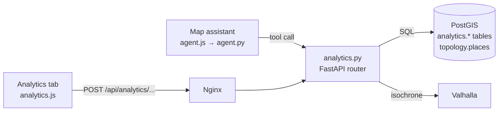

# GeoRouting Lab — Analytics

Spatial analytics for GeoRouting Lab (Phase 3 and Phase 5). This document covers what the feature does, how it works, how to set it up, the API, configuration, and operations.

**Audience:** product owners and analysts (sections 1–3), developers and operators (sections 4–11).

---

## Contents

1. [Overview](#1-overview)
2. [Core concepts](#2-core-concepts)
3. [The six analyses](#3-the-six-analyses)
4. [Architecture](#4-architecture)
5. [Data model](#5-data-model)
6. [Setup and deployment](#6-setup-and-deployment)
7. [API reference](#7-api-reference)
8. [Configuration](#8-configuration)
9. [Map assistant integration](#9-map-assistant-integration)
10. [Operations](#10-operations)
11. [Troubleshooting](#11-troubleshooting)
12. [Limitations and roadmap](#12-limitations-and-roadmap)
13. [Glossary](#13-glossary)

---

## 1. Overview

The routing tabs (Route, VRP/TSP, Isochrone, Facility) answer questions about **single trips**. Analytics answers questions about **whole areas**:

| Question | Analysis |
|---|---|
| Where are our customers? | Demand heatmap |
| Where do deliveries fail? | Delivery failure rate |
| Who is too far from a hospital, clinic, police or fire station? | Facility coverage |
| Where is failure *unusually* high, and why? | Failure hot spots |
| Where should the next N lockers, branches or clinics go? | Suggest new sites |
| Which address pins are in the wrong place? | Delivery-point corrections |

Analytics is available in two ways:

- **Analytics tab** in the sidebar: choose an analysis, set options, press **Analyze this view**.
- **Map assistant**: ask in English or Arabic, for example *"What share of addresses in this view is within 15 minutes of a hospital?"* The assistant runs the same code and draws the same results.

The analyses are designed to be used together. Hot spots show *where* and *why* deliveries fail; delivery-point corrections show *which pins* to fix there. Coverage shows *who is underserved*; site selection shows *where to build* to fix it.

---

## 2. Core concepts

### 2.1 The analysis area

Every analysis runs on the **area visible on the map** (sent as a bounding box: west, south, east, north). The map assistant can also use a circle (centre point plus radius, up to 40 km).

The area is limited to **3,000 km²** by default (roughly Riyadh's built-up area) to protect the server. Larger areas return a clear error asking the user to zoom in.

### 2.2 H3 hexagons

All data is grouped into **H3 hexagons**, a global grid of equal-sized hexagons developed by Uber.

| UI label | H3 resolution | Approximate area | Typical scale |
|---|---|---|---|
| Small | 9 | 0.1 km² | A few blocks |
| Medium (default) | 8 | 0.7 km² | A neighbourhood |
| Large | 7 | 5.2 km² | A district |

Hexagons are used for two reasons:

- **Speed.** Millions of address points become a few thousand hexagons. Each address is tagged with its hexagon ids once, at load time, so analyses only need a `GROUP BY`.
- **Fair comparison.** Every hexagon is the same size, unlike administrative districts, so values can be compared directly.

### 2.3 Demand

**Demand** is anything that represents where service is needed: National Address points, customers, households. Each demand point has a **weight**, 1 per address by default, or population, or parcels per month. Coverage and site selection measure results in *weighted demand*, so "39.5% coverage" means 39.5% of the total weight.

### 2.4 Travel-time areas (isochrones)

Coverage and site selection need to know *who can reach what within N minutes by road*. For each facility or candidate site, the server asks Valhalla for an **isochrone**: the area reachable within the time limit on the real road network. It then checks which hexagon centres fall inside that area.

The **direction** option matters because one-way streets make the two directions differ:

| Option | UI label | Meaning | Typical use |
|---|---|---|---|
| `to_facility` (default) | People go there | Area *from which* people reach the site | Clinics, lockers, branches |
| `from_facility` | Service goes out | Area the site *can reach* | Ambulances, fire trucks, delivery vans |

### 2.5 Standard result shape

Every analysis returns the same four parts:

| Part | Used by | Contents |
|---|---|---|
| `summary` | Map assistant | Small set of key numbers, plus top items with coordinates |
| `stats` | Sidebar table | `[label, value]` rows. The first row is the headline, shown in green |
| `legend` | Sidebar legend | Colour and label pairs |
| `layers` | Map | Shapes to draw: `polygon` (hexagons, clusters), `line` (pin offsets), `points` (markers) |

---

## 3. The six analyses

### 3.1 Demand heatmap

**Question:** Where is demand concentrated?

**How it works:** sums demand weight per hexagon and colours hexagons in five classes from dark blue (low) to yellow (high). Each colour holds roughly the same number of hexagons (quantile classes), so a few extreme hexagons don't wash out the rest of the map.

**Options:** hexagon size.

**Reading the result:** yellow hexagons are where business is concentrated. Use this as the starting point for capacity, branch and locker planning.

### 3.2 Delivery failure rate

**Question:** What share of delivery attempts fail in each area?

**How it works:** for each hexagon, failed attempts ÷ all attempts over the chosen period (7, 30 or 90 days). Hexagons with fewer than 5 attempts are left out, because a rate based on 1 failure out of 2 attempts is not meaningful.

**Options:** period, hexagon size.

**Reading the result:** a quick overview of problem areas. Use **Failure hot spots** to confirm which ones are statistically real.

### 3.3 Facility coverage

**Question:** What share of demand is within N minutes of the nearest facility of a type?

**How it works:**

1. Collect demand per hexagon in the view.
2. Collect existing facilities of the chosen type from `topology.places`, including a margin outside the view, because a hospital just outside the map still serves people inside it.
3. Request two isochrones per facility: the time limit (for example 15 min) and a "near" band of 1.5× the limit (for example 23 min).
4. Give each hexagon the best band it falls into from any facility.
5. Coverage = demand in covered hexagons ÷ all demand.

| Colour | Meaning |
|---|---|
| Green | Within the time limit (covered) |
| Amber | Within 1.5× the limit |
| Red | Beyond 1.5× the limit, or not reachable |

**Options:** facility type, time limit (5–60 min), transport (car, bike, walk), direction, hexagon size.

**Reading the result:** the headline is the coverage percentage. Click a hexagon to see its demand, time band and nearest facility. The assistant also receives the five largest uncovered hexagons, so it can name the worst areas.

**Typical users:** Ministry of Health and municipal planning (accessibility), emergency services (response times), network planning.

### 3.4 Failure hot spots

**Question:** Where are delivery failures *unusually* common, with statistical confidence, and why?

**Method 1: Hexagon stats (default), Getis-Ord Gi\***

For each hexagon, the method looks at the hexagon **together with its 6 neighbours** and compares that neighbourhood's failure rate with the area average. The result is a **z-score**: how far the neighbourhood is from normal, relative to random variation.

| z-score | Meaning | Colour |
|---|---|---|
| ≥ 2.58 | Hot spot, 99% confidence | Strong red |
| ≥ 1.96 | Hot spot, 95% confidence | Red-orange |
| ≥ 1.65 | Hot spot, 90% confidence | Light orange |
| ≤ −1.96 | Cold spot (better than normal), 95%+ | Blue |
| between | Not significant | Not drawn |

Two design choices make this reliable:

- **Failure rate, not failure count, by default.** Raw counts mostly highlight busy areas: more deliveries means more failures. In testing, counts flagged 70 false hexagons out of 92; rate flagged 8 out of 30.
- **Smoothing.** Each hexagon's rate is pulled toward the area average by 20 imaginary attempts: `(failed + 20 × average) ÷ (attempts + 20)`. A small hexagon with 2 failures out of 5 (raw 40%) becomes about 13%; a large one with 40 out of 100 stays at about 34%. This stops small, noisy hexagons from looking like hot spots.

The sidebar also shows the **top failure reason inside the hot spots** (for example `address_not_found`), which tells you what to fix.

**Method 2: Point clusters, DBSCAN**

Groups individual failed attempts that lie close together (default: at least 8 failures within 250 m of each other). A cluster must involve **at least 3 different addresses**: one address failing ten times is a customer problem, not an area problem. Clusters are drawn as outlines; the top 10 get numbered markers showing their size and most common reason.

**Options:** method, period, hexagon size.

### 3.5 Suggest new sites

**Question:** Where should N new sites go to cover the most demand within T minutes?

This is the **Maximal Coverage Location Problem (MCLP)**.

**How it works:**

1. **Existing coverage.** If a facility type is selected under "Keep existing facilities", demand those facilities already reach is marked as covered. New sites get no credit for it.
2. **Candidates.** Demand is summed into the next-larger hexagon size, and the centres of the 80 busiest larger hexagons become candidate sites (roughly one every 1–2 km where demand is). Callers of the API can supply their own candidates instead, for example a list of available plots.
3. **Reachability.** One isochrone per candidate gives the set of hexagons it can serve.
4. **Choice.**
   - **Fast (greedy, default):** pick the candidate that covers the most uncovered demand; then the one that covers the most of what is *still* uncovered; repeat. This is fast and proven to reach at least 63% of the best possible result. In practice it is usually within a few percent.
   - **Best (exact):** Google OR-Tools searches for the optimal combination for up to 20 seconds. In testing it improved coverage from 85.0% to 85.9% and took about 24 seconds. If OR-Tools is not installed, it falls back to greedy and says so.

**Reading the result:**

- Numbered markers show sites in order of value: **site 1 adds the most**. If the budget allows only two, build sites 1 and 2.
- Each site's coverage area is drawn in its own colour; blue is existing coverage; grey is still uncovered.
- The sidebar shows coverage before and after. Each site's popup shows the demand it adds and the cumulative coverage.

> **Candidates, not decisions.** The model knows only travel time and demand. Land availability, rent, zoning and permits must be checked on site. Both the sidebar and the assistant state this.

**Options:** keep existing facilities (type or none), time limit, number of new sites (1–20), transport, direction, hexagon size, solver.

### 3.6 Delivery-point corrections

**Question:** Which address pins are far from where drivers actually deliver?

**How it works (learning step):** for every address with at least 3 successful deliveries that have a GPS position:

1. Ignore GPS readings more than 500 m from the official pin (phone glitches, wrong scans).
2. Take the **median** point of the drops. The median, unlike the average, is not dragged off by one wild reading.
3. Discard drops more than 150 m from that median.
4. Take the median again: this is the **learned delivery point**.
5. Compute the **offset** (official pin to learned point) and the **spread** (median distance of the drops to the learned point).
6. Compute a **confidence** score from 0 to 1 by multiplying three factors:

| Factor | Formula | Example |
|---|---|---|
| Amount of data | `min(1, drops used ÷ 5)` | 3 drops → 0.6; 5+ drops → 1.0 |
| Agreement | `drops used ÷ all drops` | 9 of 10 kept → 0.9 |
| Tightness | `exp(−spread ÷ 40 m)` | 10 m spread → 0.78; 40 m → 0.37 |

**Reading the result:** each flagged address gets a line from the official pin to the learned point, coloured by distance (yellow under 50 m, amber 50–100 m, red over 100 m), and a green marker at the learned point. Only addresses with confidence ≥ 0.5 and offset ≥ the chosen threshold (default 30 m) are shown, largest offsets first.

A large, consistent offset usually means the pin is on the wrong side of the building, or the real entrance is a gate around the corner.

**Why it matters:** correct pins mean fewer failed first attempts and shorter stops, and they improve the National Address data itself.

**Review workflow:** every learned point has a `review_status` (`pending`, `approved`, `rejected`). When learning runs again, a reviewed point keeps its status unless it moved by more than 10 m, in which case it returns to `pending`. There is no approval screen yet (see [roadmap](#12-limitations-and-roadmap)).

**Options:** minimum offset to show. The **Re-learn delivery points from GPS** button runs the learning step; normally it runs nightly (see [operations](#101-scheduled-learning)).

---

## 4. Architecture

### 4.1 Components



| File | Role |
|---|---|
| `routing-api/analytics.py` | All analyses, the reachability engine, HTTP endpoints, agent tools |
| `routing-api/app.py` | Mounts the analytics router (bottom of file); provides the database pool and HTTP client |
| `routing-api/agent.py` | Imports `AGENT_TOOLS` and `AGENT_FUNCS` from `analytics.py` |
| `frontend/js/analytics.js` | Analytics tab: form, requests, drawing, popups, cancel |
| `frontend/css/analytics.css` | Analytics tab styles |
| `frontend/index.html` | Analytics tab markup |
| `frontend/js/scripts.js` | Two hooks: clear analytics on tab switch; restore layers after a basemap switch |
| `nginx.conf` | `/api/analytics/` route with a 300 s timeout |
| `sql/001_analytics_schema.sql` | Tables and indexes |
| `scripts/load_h3.py` | Fills hexagon ids for imported data |
| `scripts/generate_test_data.py` | Synthetic test data with planted patterns |
| `scripts/smoke_test.py` | End-to-end checks against the live API |

### 4.2 Request flow

1. The browser sends the visible bounding box and options to `/api/analytics/<analysis>`.
2. FastAPI validates the request against its model (types, ranges, allowed values). Invalid requests get HTTP 422 before any analysis code runs.
3. The endpoint calls `_run`, which starts the analysis as a background task and checks every second whether the browser is still connected. If the user closes the tab, presses **Clear**, or switches tab, the work is cancelled so Valhalla is not loaded for nobody.
4. The analysis function checks the area size, queries PostGIS, and (for coverage and site selection) requests isochrones.
5. The response returns `summary`, `stats`, `legend`, `layers`, plus `seconds` (run time).

### 4.3 Reachability engine and safety rails

Coverage and site selection share one engine (`_isochrones` + `_inside`):

- **One isochrone request per site.** Valhalla stops searching at the time limit, so each request is small.
- **Point-in-polygon locally.** Hexagon centres are tested against each area with numpy and shapely: a cheap bounding-rectangle filter first, then an exact test on the remaining points. This takes milliseconds.

Because Valhalla is shared with the routing tabs and the assistant, the engine has several protections:

| Protection | Default | Behaviour |
|---|---|---|
| Concurrency limit | 3 | At most 3 isochrone requests in flight, across all users |
| Heavy-analysis lock | 1 | Only one coverage or site-selection run at a time; others get HTTP 429 "busy" immediately instead of queueing |
| Isochrone cap | 250 | One analysis may request at most 250 isochrones (facilities + candidates) |
| Per-request timeout | 30 s | A slow isochrone is counted as failed; the analysis continues |
| Circuit breaker | 3 failures | If 3 requests fail and none succeeded, stop sending requests |
| Cache | 1 hour, 3,000 entries | Same site and settings are never requested twice within an hour. Re-running with another hexagon size is near-instant |
| Cancellation | — | Disconnected clients cancel their work (see 4.2) |
| Separate Valhalla | off | Optional `ANALYTICS_VALHALLA_URL` sends analytics to a dedicated Valhalla instance |

If some isochrones fail, the analysis still returns a result, and the sidebar shows a warning row ("⚠ Areas not computed: X of Y"), because coverage may then be underestimated. If all fail, it returns an error pointing to Valhalla.

### 4.4 Database access

- SQL runs in a worker thread, so a slow query does not block other users.
- Every query has a 60-second statement timeout.
- All user values are passed as query parameters, never pasted into SQL text. The only value inserted into SQL text is the hexagon resolution, which is checked against the allow-list `{7, 8, 9}` first.

---

## 5. Data model

All tables live in the `analytics` schema. Facilities are read from the existing `topology.places` table.

### 5.1 `analytics.demand_points`

| Column | Type | Notes |
|---|---|---|
| `id` | bigserial | Primary key |
| `source_id` | text | Id in the source system (e.g. National Address id). Unique when present |
| `short_address` | text | Optional; shown in results |
| `weight` | real | Demand weight, default 1 |
| `geom` | Point, 4326 | Location |
| `h3_r7`, `h3_r8`, `h3_r9` | text | Hexagon ids, filled at load time |

### 5.2 `analytics.deliveries`

One row per delivery **attempt**.

| Column | Type | Notes |
|---|---|---|
| `id` | bigserial | Primary key |
| `external_id` | text | Id in the delivery system |
| `address_id` | bigint | References `demand_points.id` |
| `geom` | Point, 4326 | The **official** address location (copied from `demand_points`) |
| `drop_geom` | Point, 4326 | Driver's GPS at proof of delivery (may be null) |
| `status` | text | `delivered` or `failed` |
| `failure_reason` | text | For example `address_not_found`, `customer_absent`, `no_access` |
| `attempted_at` | timestamptz | Attempt time |
| `vehicle_id` | text | Optional |
| `h3_r7`, `h3_r8`, `h3_r9` | text | Hexagon ids of the official location |

### 5.3 `analytics.learned_delivery_points`

Output of the learning step. One row per address.

| Column | Type | Notes |
|---|---|---|
| `address_id` | bigint | Primary key; references `demand_points.id` |
| `official_geom` | Point | Official pin |
| `learned_geom` | Point | Where drivers actually deliver |
| `n_used` / `n_total` | int | Drops kept after outlier removal / all successful drops with GPS |
| `offset_m` | real | Official → learned distance, metres |
| `spread_m` | real | Median distance of drops to the learned point |
| `confidence` | real | 0–1 |
| `review_status` | text | `pending`, `approved`, `rejected` |
| `updated_at` | timestamptz | Last learning run |

### 5.4 `topology.places` (existing)

Used for coverage and site selection: `id`, `name`, `type` (matched case-insensitively against the allowed facility types: hospital, clinic, police, fire station), `geom`.

---

## 6. Setup and deployment

### 6.1 Prerequisites

- PostGIS (already used by the platform)
- Valhalla with the isochrone service and the `auto`, `bicycle`, `pedestrian` costings
- Python packages (in `requirements.txt`): `h3>=4`, `shapely>=2`, `numpy`; optionally `ortools` for the exact solver

### 6.2 Install

1. **Copy files.** Put `analytics.py` in `routing-api/`, and put the `scripts/` and `sql/` folders inside `routing-api/` so they are inside the container. Replace the changed files listed in [4.1](#41-components).

2. **Create the tables.** The script is safe to re-run.
   ```bash
   docker compose exec -T postgis psql -U $POSTGRES_USER -d geodb < routing-api/sql/001_analytics_schema.sql
   ```

3. **Rebuild and restart.**
   ```bash
   docker compose build routing-api && docker compose up -d
   docker compose exec nginx nginx -t && docker compose restart nginx
   ```

4. **Check.** Open `/api/analytics/status`. It should return row counts (zero at first) and engine state.

### 6.3 Load test data and verify

```bash
# 20,000 Riyadh addresses, ~40,000 delivery attempts, with planted patterns
docker compose exec routing-api python scripts/generate_test_data.py

# End-to-end checks (from any machine that can reach the API; needs: pip install httpx)
python routing-api/scripts/smoke_test.py --base http://localhost/api
# add --admin-token XXXX if ANALYTICS_ADMIN_TOKEN is set
```

Planted patterns the smoke test checks for:

| Pattern | Expected result |
|---|---|
| Two failure hot spots (1 km radius, ~35% failure, mostly `address_not_found`) | Both found by Gi*; most hot hexagons inside them; top reason `address_not_found` |
| 15% of addresses with a consistent 40–150 m gate offset | ~15% of learned addresses moved > 30 m; median offset of flagged addresses 40–150 m |
| Normal addresses with ~8 m GPS noise | Median offset of all learned addresses < 15 m |
| 3% wild GPS readings | Ignored by the learning step |

Coverage and site selection checks also need Valhalla and some hospitals in `topology.places` inside the test area.

Remove the test data afterwards (only rows tagged `TEST-` are deleted):

```bash
docker compose exec routing-api python scripts/generate_test_data.py --cleanup
```

### 6.4 Load real data

Adapt the table and column names to your source systems:

```sql
-- National Address points → demand
INSERT INTO analytics.demand_points (source_id, short_address, weight, geom)
SELECT na.id::text, na.short_address, 1, ST_Transform(na.geom, 4326)
FROM your_schema.national_address na
ON CONFLICT (source_id) WHERE source_id IS NOT NULL DO NOTHING;

-- Delivery attempts (one row per attempt)
INSERT INTO analytics.deliveries
       (external_id, address_id, geom, drop_geom, status, failure_reason, attempted_at, vehicle_id)
SELECT s.attempt_id, a.id, a.geom,
       ST_SetSRID(ST_MakePoint(s.pod_lon, s.pod_lat), 4326),
       CASE WHEN s.result = 'DELIVERED' THEN 'delivered' ELSE 'failed' END,
       s.failure_reason, s.attempt_time, s.vehicle_id
FROM your_schema.shipment_attempts s
JOIN analytics.demand_points a ON a.source_id = s.national_address_id::text;
```

Then fill the hexagon ids. This only processes rows where they are missing, so it is safe to run after every import:

```bash
docker compose exec routing-api python scripts/load_h3.py
```

Check `/api/analytics/status`: `demand_missing_h3` and `deliveries_missing_h3` should be 0.

---

## 7. API reference

Base path: `/api/analytics` through Nginx (`/analytics` directly on the API container). All analysis endpoints are `POST` with a JSON body.

### 7.1 Area object

Used by every analysis endpoint except `/delivery_points/learn`.

```json
{ "bbox": [46.51, 24.56, 46.85, 24.86] }
```
or
```json
{ "center": { "lon": 46.68, "lat": 24.71 }, "radius_km": 5 }
```

| Field | Rule |
|---|---|
| `bbox` | `[west, south, east, north]`, exactly 4 numbers |
| `center` + `radius_km` | Alternative to `bbox`; radius > 0 and ≤ 40 |
| Size | ≤ `ANALYTICS_MAX_AREA_KM2` (default 3,000 km²) |

### 7.2 `POST /hexbin`

| Field | Default | Allowed |
|---|---|---|
| `area` | required | Area object |
| `dataset` | `demand` | `demand`, `deliveries` |
| `metric` | `count` | `count`, `failed`, `failure_rate` (`demand` supports `count` only) |
| `resolution` | 8 | 7, 8, 9 |
| `days` | 30 | 1–365 (deliveries only) |

### 7.3 `POST /coverage`

| Field | Default | Allowed |
|---|---|---|
| `area` | required | Area object |
| `facility_type` | `hospital` | `hospital`, `clinic`, `police`, `fire station` |
| `minutes` | 15 | 1–60 |
| `profile` | `auto` | `auto`, `bicycle`, `pedestrian` |
| `direction` | `to_facility` | `to_facility`, `from_facility` |
| `resolution` | 8 | 7, 8, 9 |

Summary includes `coverage_pct`, `total_demand`, `covered_demand`, `facilities_considered`, `facilities_failed`, `largest_uncovered_cells`.

### 7.4 `POST /hotspots`

| Field | Default | Allowed |
|---|---|---|
| `area` | required | Area object |
| `method` | `gi_star` | `gi_star`, `dbscan` |
| `metric` | `failure_rate` | `failure_rate`, `failed` (Gi* only) |
| `resolution` | 8 | 7, 8, 9 (Gi* only) |
| `days` | 30 | 1–365 |
| `min_attempts` | 5 | ≥ 1 (Gi* with `failure_rate`) |
| `smoothing` | 20 | 0–500 pseudo-attempts (Gi* with `failure_rate`) |
| `eps_m` | 250 | 20–2000 metres (DBSCAN) |
| `min_points` | 8 | 3–500 (DBSCAN) |

Gi* needs at least 10 hexagons with data. Summary includes `hot_cells_95`, `cold_cells_95`, `top_hotspots`, `failure_reasons_in_hotspots` (Gi*), or `clusters`, `top_clusters` (DBSCAN).

### 7.5 `POST /site_selection`

| Field | Default | Allowed |
|---|---|---|
| `area` | required | Area object |
| `n_sites` | 5 | 1–20 |
| `minutes` | 10 | 1–60 |
| `profile` | `auto` | `auto`, `bicycle`, `pedestrian` |
| `direction` | `to_facility` | `to_facility`, `from_facility` |
| `existing_facility_type` | none | A facility type, or omit to start from zero |
| `candidates` | none | `[{"lon", "lat", "label"}]`; omit to use hexagon centres |
| `max_candidates` | 80 | 5–300 |
| `resolution` | 8 | 7, 8, 9 |
| `method` | `greedy` | `greedy`, `exact` |

Summary includes `coverage_before_pct`, `coverage_after_pct`, `candidates_evaluated`, `travel_areas_failed`, and `sites` (each with `rank`, `lon`, `lat`, `label`, `added_demand`, `cumulative_coverage_pct`).

### 7.6 `POST /delivery_points/learn`

Writes to the database. Requires header `X-Admin-Token` when `ANALYTICS_ADMIN_TOKEN` is set.

| Field | Default | Allowed |
|---|---|---|
| `min_deliveries` | 3 | 2–50 |
| `inlier_radius_m` | 150 | 20–1000 |
| `max_offset_m` | 500 | 50–5000 |

Summary: `addresses`, `median_offset_m`, `over_30m`, `over_100m`, `confident`, `seconds`.

### 7.7 `POST /delivery_points/offsets`

| Field | Default | Allowed |
|---|---|---|
| `area` | required | Area object |
| `min_offset_m` | 30 | ≥ 0 |
| `min_confidence` | 0.5 | 0–1 |
| `limit` | 300 | 1–2000 |

### 7.8 `GET /status`

Row counts and engine state; no body.

```json
{
  "demand_points": 20000, "demand_missing_h3": 0,
  "deliveries": 40522, "deliveries_missing_h3": 0,
  "learned_points": 6420,
  "heavy_analysis_running": false,
  "valhalla_slots_free": 3,
  "isochrone_cache_size": 87
}
```

### 7.9 Response shape

```json
{
  "summary": { "coverage_pct": 39.5, "...": "..." },
  "stats":   [["Coverage", "39.5%"], ["Covered demand", "10,991 of 27,793"]],
  "legend":  [{ "color": "#22d98a", "label": "≤ 15 min (covered)" }],
  "layers":  [{ "kind": "polygon", "label": "hospital coverage", "color": null,
                "opacity": 0.5, "geojson": { "type": "FeatureCollection", "features": [] } }],
  "seconds": 0.14
}
```

Feature properties carry per-feature `color` and the values shown in click popups (for example `demand`, `minutes`, `nearest`, `z`, `failed`, `attempts`, `served_by`).

### 7.10 Status codes

| Code | Meaning | Typical cause |
|---|---|---|
| 200 | Success | |
| 400 | Request can't be analysed | Area too large, no data in area, unknown facility type, too many isochrones, Valhalla returned nothing |
| 401 | Admin token required | `/learn` without a valid `X-Admin-Token` |
| 422 | Invalid input | Value out of range or wrong type (FastAPI validation) |
| 429 | Busy | Another coverage or site-selection run is in progress |
| 499 | Client closed the request | Browser disconnected; work was cancelled |
| 503 | Database unavailable | Connection pool down |

---

## 8. Configuration

Set in the `routing-api` service environment (docker-compose or Kubernetes).

| Variable | Default | Purpose |
|---|---|---|
| `ANALYTICS_MAX_AREA_KM2` | 3000 | Largest area one analysis may cover |
| `ANALYTICS_VALHALLA_URL` | unset | Dedicated Valhalla for analytics (e.g. `http://valhalla-analytics:8002`). Unset = shared Valhalla |
| `ANALYTICS_VALHALLA_CONCURRENCY` | 3 | Isochrone requests in flight, all users together |
| `ANALYTICS_MAX_HEAVY` | 1 | Coverage/site-selection runs at the same time |
| `ANALYTICS_MAX_ISOCHRONES` | 250 | Isochrones per analysis |
| `ANALYTICS_ISO_TIMEOUT_S` | 30 | Timeout per isochrone request |
| `ANALYTICS_ISO_CACHE_TTL_S` | 3600 | How long isochrones stay cached |
| `ANALYTICS_ADMIN_TOKEN` | unset | Required for `/delivery_points/learn` when set. **Set in production** |

Nginx: `/api/analytics/` has a 300-second read timeout. `/api/agent/` also has 300 seconds, because the assistant can run site selection. The browser cancels an analysis after 290 seconds.

---

## 9. Map assistant integration

`analytics.py` exports five read-only tools that `agent.py` adds to its tool list:

| Tool | Analysis |
|---|---|
| `area_heatmap` | Demand or delivery heatmap |
| `coverage_analysis` | Facility coverage |
| `find_hotspots` | Failure hot spots |
| `suggest_sites` | Site selection |
| `delivery_point_corrections` | Pin corrections (read only) |

- The browser sends the current map bounding box with every question. If the user names no area, the assistant uses the visible map.
- The assistant receives only `summary`; the map receives `layers`.
- Errors such as "area too large" come back as readable messages, so the assistant can ask the user to zoom in.
- The assistant **cannot** run the learning step, which writes to the database.
- The system prompt instructs the assistant to present suggested sites as candidates that need on-site checks, and to state the time window behind failure numbers.
- In mock mode (no AI model), keyword rules handle phrases such as "hot spots", "hospital coverage 15 min", "suggest 5 sites", "demand heatmap" and "wrong pins".

---

## 10. Operations

### 10.1 Scheduled learning

Run delivery-point learning nightly, after the day's deliveries are imported. Example cron entry on the host:

```bash
0 2 * * * curl -s -X POST http://localhost/api/analytics/delivery_points/learn \
  -H "Content-Type: application/json" -H "X-Admin-Token: $ANALYTICS_ADMIN_TOKEN" -d '{}'
```

Re-run `scripts/load_h3.py` after each data import as well.

### 10.2 Monitoring

- **`/api/analytics/status`:** data counts, whether a heavy analysis is running, free Valhalla slots, cache size.
- **Logs** (`docker compose logs routing-api`): each analysis logs its run time; failed isochrones log the site, coordinates and error type; cancelled runs log "Client disconnected".

### 10.3 Performance (test environment)

| Analysis | Test area (~1,000 km², 20k addresses) | Notes |
|---|---|---|
| Heatmaps | < 0.2 s | Database only |
| Hot spots | < 0.5 s | Database only |
| Delivery-point learning | ~2 s | 40k attempts; scales with delivery volume |
| Coverage | Seconds | One isochrone per facility; cached for an hour |
| Site selection (greedy) | Seconds to ~1 min | One isochrone per candidate (up to 80) |
| Site selection (exact) | + up to 20 s | Solver time limit |

These timings used a simulated Valhalla. Real isochrone times depend on your Valhalla hardware, the time limit, and the road network.

---

## 11. Troubleshooting

| Symptom | Likely cause | Fix |
|---|---|---|
| "Area is X km², the limit is 3,000 km²" | Zoomed out too far | Zoom in, or raise `ANALYTICS_MAX_AREA_KM2` with care |
| "No demand points in this area" | No data loaded, or hexagon ids missing | Check `/status`; run `load_h3.py` |
| "Only N hexagons have data" (hot spots) | Too few deliveries in the area or period | Longer period, larger area, or larger hexagons |
| "Busy: another coverage or site analysis is running" | Heavy-analysis lock | Wait and retry; raise `ANALYTICS_MAX_HEAVY` only if Valhalla has capacity |
| "Valhalla did not return any travel-time area" | Valhalla down, overloaded, or missing tiles for the area | `docker logs valhalla`, `docker stats`; check tiles cover the region |
| "⚠ Areas not computed: X of Y" | Some isochrones timed out | Coverage may be low; retry (successful ones are cached), or raise `ANALYTICS_ISO_TIMEOUT_S` |
| "This needs N travel-time areas (limit 250)" | Many facilities in view, or many candidates | Zoom in, reduce candidates, or raise `ANALYTICS_MAX_ISOCHRONES` |
| Coverage lower than expected | Facilities missing from `topology.places`, or wrong `type` values | Check facility data and type spelling |
| Site selection returns no sites | Existing facilities already cover all demand | Use a shorter time limit |
| "Took too long" in the browser | Run exceeded 290 s | Zoom in, use larger hexagons, or use the Fast solver |
| Learning returns 0 addresses | Fewer than 3 GPS-tagged successful deliveries per address, or `drop_geom` empty | Check the import maps proof-of-delivery GPS into `drop_geom` |
| "Admin token required" | `ANALYTICS_ADMIN_TOKEN` is set | Send `X-Admin-Token`; the UI prompts for it |

---

## 12. Limitations and roadmap

**Current limitations**

- Coverage uses **hexagon centres**: a hexagon counts as covered if its centre is inside a reachable area. At Medium size (~0.7 km²) this is accurate enough for planning, not for individual addresses.
- Travel times come from Valhalla's road model **without live traffic**. Rush-hour access can be worse than shown. Phase 2 (speed profiles from GPS) would address this.
- Site candidates are hexagon centres, not real plots. Supply your own `candidates` via the API to evaluate actual available locations.
- The isochrone cache and rate limits are **in memory** and per API instance. With several replicas, each has its own cache and limits.
- Facility types are limited to the allow-list in `app.py`.
- Learned delivery points have a review status but **no approval screen**.

**Suggested next steps**

1. A review screen for learned delivery points (approve or reject, export approved corrections).
2. Candidate upload in the Analytics tab (CSV of available plots).
3. Population weights (for example Kontur H3 population data) for health-access coverage.
4. Time-of-day coverage once speed profiles exist (Phase 2).
5. Shared cache and limits (Redis) for multi-replica deployments.

---

## 13. Glossary

| Term | Meaning |
|---|---|
| **Bounding box (bbox)** | The rectangle `[west, south, east, north]` describing the visible map area |
| **Coverage** | Share of demand within the time limit of at least one facility |
| **DBSCAN** | A clustering method: points with enough close neighbours form a cluster; isolated points are ignored |
| **Demand** | Weighted locations needing service (addresses, customers, population) |
| **Getis-Ord Gi\*** | A statistic that tests whether a location *and its neighbours* have unusually high or low values |
| **Greedy algorithm** | Builds a solution step by step, always taking the best next option |
| **H3** | Uber's global hexagon grid; each hexagon has a text id such as `8853a8d8a1fffff` |
| **Isochrone** | The area reachable within a given travel time |
| **MCLP** | Maximal Coverage Location Problem: choose N sites to cover the most demand within a distance or time |
| **Median** | The middle value; unlike the average, not affected by a few extreme values |
| **Offset** | Distance between the official address pin and the learned delivery point |
| **Quantile classes** | Colour classes that each contain about the same number of hexagons |
| **Spread** | How tightly a driver's GPS drops agree (median distance to the learned point) |
| **z-score** | How many "normal variations" a value is from the average; ±1.96 ≈ 95% confidence |